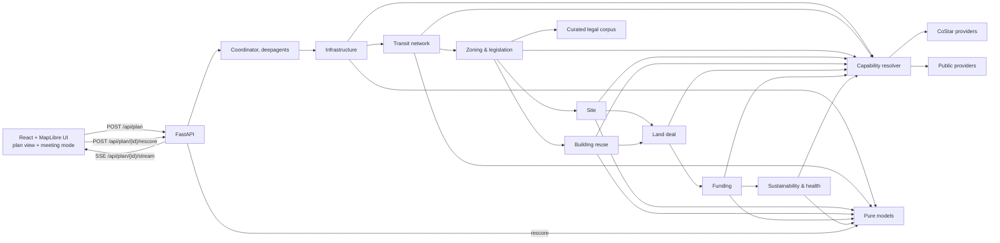

# 02: Architecture

## Components



## Two paths through the system

- **Full plan (slow, minutes):** the coordinator runs the agents in the order above. LLM calls are allowed. The result is a `Plan` saved to `cache/plans/{id}.json`, plus the SSE event log for replay.
- **Re-score (fast, under 1 s):** meeting-mode tiles and the slider call `rescore(plan, edits)`, which uses only pure functions in `backend/models/`: no LLM, no network. Everything expensive is precomputed when the plan is built.

## Shared schemas (`backend/schemas.py`)

The contract between agents, API and UI. Change here first, then mirror in `frontend/src/types.ts`.

```python
from pydantic import BaseModel
from typing import Literal, Optional, Generic, TypeVar
from datetime import datetime

T = TypeVar("T")
Confidence = Literal["high", "medium", "low", "missing"]

class Provenance(BaseModel):
    source: str                 # "costar", "vexcel", "matterport", "county_parcels", "osm", "fema", "corpus", ...
    confidence: Confidence
    retrieved_at: datetime
    url: Optional[str] = None
    note: Optional[str] = None  # e.g. "lease data unavailable; verify before outreach"

class Sourced(BaseModel, Generic[T]):
    value: Optional[T]
    prov: Provenance

class Locale(BaseModel):
    id: Literal["houston_downtown", "la_wilshire_koreatown", "brevard_cocoa"]
    name: str
    purpose: str                # one sentence, from docs/11-test-locales.md
    data_tier: Literal["costar_full", "public_only"]
    jurisdiction: str
    bbox: tuple[float, float, float, float]   # min lon, min lat, max lon, max lat
    stations: list[tuple[float, float]]

class Parcel(BaseModel):
    id: str
    geometry: dict              # GeoJSON polygon
    area_acres: Sourced[float]
    land_use: Sourced[str]      # "surface_parking", "retail_1story", "vacant", "office", ...
    owner: Sourced[str]
    last_sale_usd: Sourced[float]
    last_sale_year: Sourced[int]
    lease_expiry_year: Sourced[int]

class Building(BaseModel):      # existing structure on a parcel
    id: str
    parcel_id: str
    footprint: dict             # GeoJSON
    property_type: Sourced[str]         # office, retail, hotel, industrial, parking_garage, ...
    building_class: Sourced[str]        # A, B, C
    year_built: Sourced[int]
    year_renovated: Sourced[int]
    stories: Sourced[int]
    rentable_area_sqft: Sourced[float]
    typical_floor_sqft: Sourced[float]
    vacancy_pct: Sourced[float]
    asking_rent_usd_sqft_yr: Sourced[float]
    parking_spaces: Sourced[int]
    floor_depth_ft: Sourced[float]       # core-to-window; Matterport or derived from footprint
    ceiling_height_ft: Sourced[float]    # Matterport
    window_wall_pct: Sourced[float]      # Matterport or imagery estimate
    roof_area_sqft: Sourced[float]       # Vexcel or footprints

UseType = Literal["residential", "hotel", "mixed_use", "keep_current"]

class FitScores(BaseModel):     # each 0–1, computed in models/reuse.py
    physical: float
    legal: float
    market: float
    financial: float
    location: float

class ConversionCandidate(BaseModel):
    building_id: str
    best_use: UseType
    scores_by_use: dict[UseType, FitScores]
    overall: float
    est_units: Optional[int]
    blockers: list[str]          # e.g. "floor depth 95 ft exceeds residential threshold"
    legal_path: Optional["LegalPath"]
    embodied_co2_saved_tonnes: Optional[float]

class InfraFeature(BaseModel):
    kind: Literal["rail", "bus_route", "bus_stop", "sidewalk", "bike_lane", "water_main", "sewer_main",
                  "power_substation", "ev_charger", "broadband", "school", "clinic", "park", "grocery", "flood_zone"]
    geometry: dict
    attrs: dict
    prov: Provenance

class InfraReadiness(BaseModel):
    target_id: str              # parcel or building id
    score: float                # 0–1
    present: list[str]          # what's within reach
    gaps: list[str]             # e.g. "no sidewalk on 2 of 4 frontages", "sewer data not public here"

class Stop(BaseModel):
    id: str
    lonlat: tuple[float, float]
    route_ids: list[str]
    riders_per_day_low: float
    riders_per_day_high: float
    prov: Provenance

class Route(BaseModel):
    id: str
    kind: Literal["rail_existing", "bus_existing", "frequent_bus", "brt", "on_demand_zone"]
    geometry: dict
    headway_min: Optional[int]
    phase: int
    annual_operating_cost_usd: float

class MeasurementSuggestion(BaseModel):
    what: str                   # "manual weekday passenger count at stop S4, 7–9 am"
    target_id: str
    expected_range_narrowing_pct: float

class TransitPlan(BaseModel):
    routes: list[Route]
    stops: list[Stop]
    measurements: list[MeasurementSuggestion]
    budget_usd: float

class Citation(BaseModel):
    doc_id: str
    section: str
    quote: str                  # short verbatim excerpt from the corpus
    url: Optional[str]

class LegalPath(BaseModel):
    name: str                   # "SB 79 new construction", "LA Citywide Adaptive Reuse", "Houston development rules"
    eligible: Optional[bool]    # None = not covered by corpus
    allows: dict                # e.g. {"max_height_ft": ..., "max_units": ..., "parking_min_per_unit": ...}
    citations: list[Citation]

class ZoningEnvelope(BaseModel):
    parcel_id: str
    paths: list[LegalPath]
    recommended_path: Optional[str]
    covered: bool

class Site(BaseModel):
    id: str
    kind: Literal["new_build", "conversion"]
    parcel_ids: list[str]
    building_id: Optional[str]  # set for conversions
    geometry: dict
    homes: int
    height_ft: float
    status: Literal["pursue", "pass", "watch"]

class DealStrategy(BaseModel):
    site_id: str
    strategy: Literal["buy", "ground_lease", "joint_development", "owner_partnership", "pass"]
    reasons: list[str]
    letter_draft: Optional[str]

class CapitalStack(BaseModel):
    site_id: str
    total_cost_usd: float
    debt_usd: float
    tax_credit_equity_usd: float
    incentive_usd: float        # e.g. local per-unit rebate, when a factor exists for it
    investor_equity_usd: float
    gap_usd: float
    pencils: bool
    assumptions: list[str]      # factors.yaml keys used

class TargetScore(BaseModel):
    key: Literal["transport_co2", "embodied_co2_saved", "rooftop_solar", "walk_access", "flood_exposure"]
    value: float
    unit: str
    target: Optional[float]
    factor_keys: list[str]

class Plan(BaseModel):
    id: str
    locale: Locale
    infrastructure: list[InfraFeature]
    readiness: list[InfraReadiness]
    transit: TransitPlan
    parcels: list[Parcel]
    buildings: list[Building]
    envelopes: list[ZoningEnvelope]
    conversions: list[ConversionCandidate]
    sites: list[Site]
    deals: list[DealStrategy]
    stacks: list[CapitalStack]
    targets: list[TargetScore]
    created_at: datetime

class Edit(BaseModel):          # from meeting mode or the slider
    kind: Literal["place_tile", "remove_tile", "slider"]
    tile: Optional[Literal["homes", "park", "stop", "convert_residential", "convert_hotel"]] = None
    target_id: Optional[str] = None   # parcel or building id
    value: Optional[float] = None
```

## API

| Method | Path | Body / result |
| --- | --- | --- |
| GET | `/api/locales` | The three `Locale`s |
| POST | `/api/plan` | `{locale_id?, boundary?, area_name?, prompt, options?}` → `{plan_id}`; starts the run. No boundary: whole recorded locale. Boundary inside a recorded bbox: sub-area plan (parcels, buildings and demand clipped). Elsewhere in the US: custom area recorded live into `cache/areas/<id>/` first (409 when `DEMO_OFFLINE=1`). 422 for invalid, too large (`custom_area_max_km2`) or edge-crossing boundaries. `options` default to `parse_prompt(prompt)` |
| GET | `/api/plan/{id}/stream` | SSE events; `?replay=1` replays a recorded run |
| GET | `/api/plan/{id}` | Full `Plan` |
| POST | `/api/plan/{id}/rescore` | `{edits: Edit[]}` → `{plan, deltas}` in under 1 s |
| GET | `/api/buildings/{id}` | Building with conversion detail and sources |
| GET | `/api/corpus/{doc_id}#{section}` | Source text for a citation |
| GET | `/api/factors` | All factors with `verified` flags |
| GET | `/api/geocode?q=` | Up to 6 `{label, lonlat, bbox, recorded_locale_id}`: recorded locales by alias first, then Nominatim (US, cached) |
| GET | `/api/stock_prompts` | `StockPrompt[]` from `backend/agents/stock_prompts.yaml` |
| POST | `/api/parse_prompt` | `{prompt}` → `PlanOptions` (regex rules in `backend/agents/plan_options.py`, never the LLM) |

### SSE event shape

```json
{"agent": "building_reuse", "status": "running|done|error", "step": "Scoring 42 office buildings", "payload": {...partial Plan fields...}}
```
